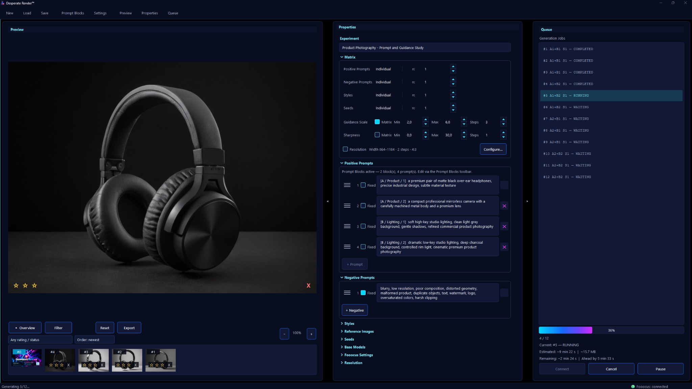
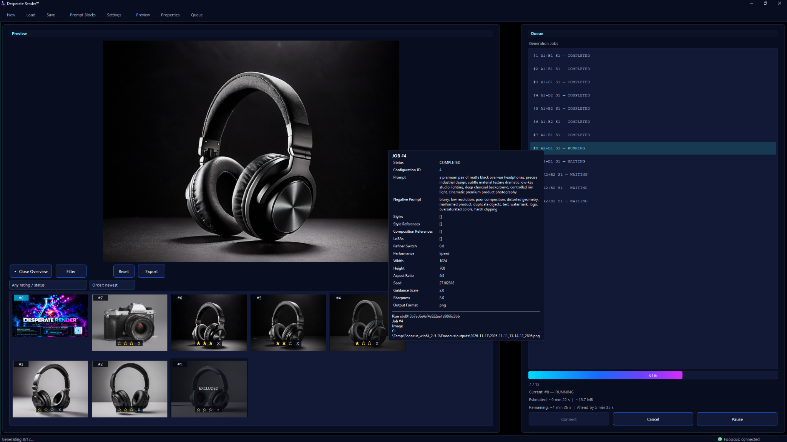
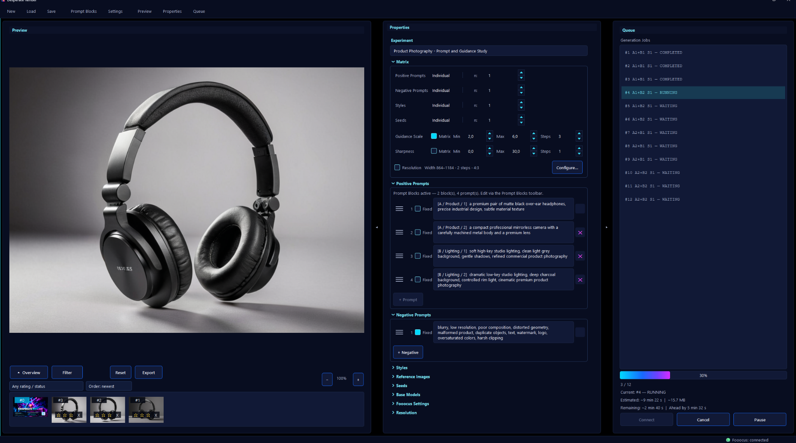
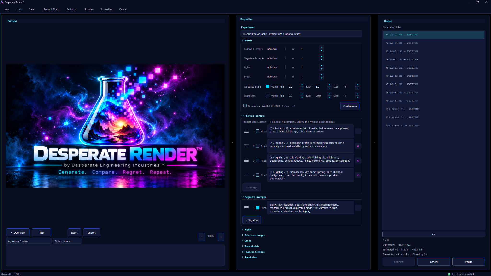

<div align="center">

# DESPERATE RENDER™

### Generate. Compare. Regret. Repeat.

**A powerful desktop GUI for Fooocus image generation and structured experiment management.**

[](LICENSE)
[](#requirements)
[](#requirements)
[](https://github.com/Hansanaut/DesperateRender/releases)

</div>

---

## Take control of your image-generation experiments

Desperate Render turns Fooocus image generation into a structured, repeatable workflow. Build prompt sets, combine generation parameters, run jobs in a queue, and review the results in one desktop application.

Instead of changing one setting at a time and losing track of what worked, Desperate Render helps you **design experiments, compare variations, and keep their results organized**.

> Desperate Render is a desktop front end for a separately installed Fooocus instance. It does not bundle or replace Fooocus.

## See it in action



The workspace brings together the image preview, experiment configuration, and generation queue. You can inspect generated images while keeping the experiment setup and job progress in view.

### Review results and inspect individual jobs



Browse generated images, inspect job parameters, and review the configuration behind an individual result.

### Build structured experiments



Combine positive and negative prompts, styles, seeds, guidance scale, sharpness, and resolution settings into structured generation runs.

### Run and monitor generation jobs



Submit multiple configurations and monitor the queue as Fooocus processes each generation.

## What you can do

- **Prompt management** — organize positive and negative prompts using prompt blocks.
- **Experiment matrices** — combine prompt and parameter variations to explore multiple configurations systematically.
- **Generation queue** — submit and monitor multiple jobs.
- **Result review** — browse generated images, filter results, and inspect job configuration details.
- **Experiment persistence** — save and reload experiment configurations and continue working with them.
- **Export workflows** — export image overviews for review and comparison.

## Requirements

Release 1.0 is a **source-only release**. It does not include a prebuilt Windows executable or installer.

- Windows 10/11 (primary target; other platforms are not certified for this release)
- Python 3.14, 64-bit, with the Python Launcher (`py.exe`)
- A separately installed and running Fooocus instance with its Gradio interface enabled
- Sufficient disk space for Python dependencies, generated images, and experiment history

The pinned dependency set was validated with Python 3.14.6 against a local Fooocus instance using Gradio 3.41.2. Other Fooocus versions may expose different API behavior.

## Installation and start

1. Install Python 3.14 (64-bit) and ensure the Python Launcher is available.
2. Download the source using **Code → Download ZIP** on this GitHub page, or clone this repository. Once a tagged release is published, you can also use the [GitHub Releases page](https://github.com/Hansanaut/DesperateRender/releases).
3. Extract the archive to a writable folder.
4. Run `INSTALL.bat`. It creates `.venv` if needed and installs the pinned dependencies from `requirements.txt`. An existing `.venv` is reused.
5. Start Fooocus separately and make sure its Gradio endpoint is reachable.
6. Run `Start_DR.bat`.

The batch files keep their console window open so installation and runtime errors remain visible.

### Manual installation

From the project root in PowerShell:

```powershell
py -3.14 -m venv .venv
.\.venv\Scripts\python.exe -m pip install --upgrade pip
.\.venv\Scripts\python.exe -m pip install -r requirements.txt
.\.venv\Scripts\python.exe main.py
```

## Connect to Fooocus

Desperate Render connects to a separately installed Fooocus process through `gradio_client`.

Use the address configured by your local Fooocus installation. The commonly used local default in the development setup is `http://127.0.0.1:7865`; verify the actual address and port in your Fooocus environment.

Fooocus is an independent third-party project. Install it separately and comply with its own license and model/asset terms. No Fooocus source code or model weights are included in this repository.

## Documentation

- [AI Experiment Creation Playbook](docs/DESPERATE_RENDER_AI_EXPERIMENT_CREATION_PLAYBOOK.md)
- [Experiment JSON Guide — English](docs/DESPERATE_RENDER_AI_EXPERIMENT_JSON_GUIDE_REV2_EN.md)
- [Experiment JSON Guide — German](docs/DESPERATE_RENDER_AI_EXPERIMENT_JSON_GUIDE_REV2.md)
- [Style Guide](docs/DESPERATE_RENDER_STYLE_GUIDE.md)
- [Third-Party Notices](docs/THIRD_PARTY_NOTICES.md)
- [Release Notes](docs/release/RELEASE_NOTES.md)
- [Release Test Report](docs/release/RELEASE_TEST_REPORT.md)

## Community and support

Have a question, an idea, or an experiment to share?

- **[GitHub Discussions](https://github.com/Hansanaut/DesperateRender/discussions)** — questions, workflows, feedback, and community exchange.
- **[GitHub Issues](https://github.com/Hansanaut/DesperateRender/issues)** — reproducible bugs and concrete technical tasks.
- **[Releases](https://github.com/Hansanaut/DesperateRender/releases)** — source packages and release information.

When reporting a problem, include your Desperate Render version, Python version, Fooocus version, steps to reproduce the issue, and any relevant error messages.

## Release status and known limitations

The project owner confirmed the core experiment workflows, matrix operators, save/load/continue behavior, Fooocus connection, image generation, and Preview behavior on Windows. See the [Release Test Report](docs/release/RELEASE_TEST_REPORT.md) for the test scope and remaining limitations.

This is not a claim that every automated test or every supported platform has been certified. The fresh-venv creation branch of `INSTALL.bat` has not yet been exercised separately; the isolated Python environment and dependency installation were previously created and validated manually, and the batch installer was then run successfully using that environment.

## License

Desperate Render is released under the **GNU General Public License, version 3 or (at your option) any later version** (GPL-3.0-or-later). See [LICENSE](LICENSE) and [Copyright information](docs/release/COPYRIGHT.md).

Third-party dependencies are installed separately by the recipient; their licenses remain applicable. See [Third-Party Notices](docs/THIRD_PARTY_NOTICES.md) and `licenses/third_party/` for the dependency inventory and included license texts.

The Windows/PyInstaller binary distribution is **not** part of this release. No binary redistribution or Qt/PySide LGPL compliance conclusion is implied by this source-only package.

---

<div align="center">

**DESPERATE RENDER™**  
*Generate. Compare. Regret. Repeat.*

</div>
